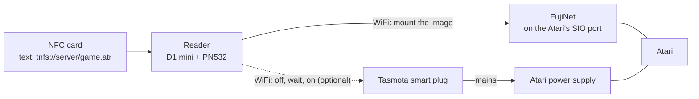
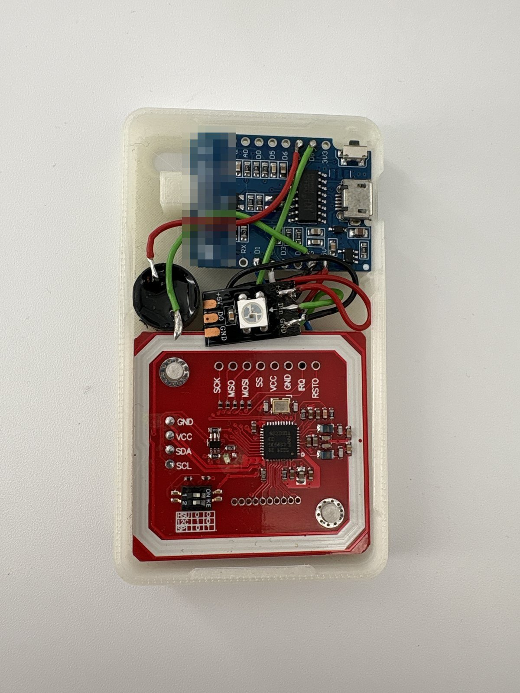
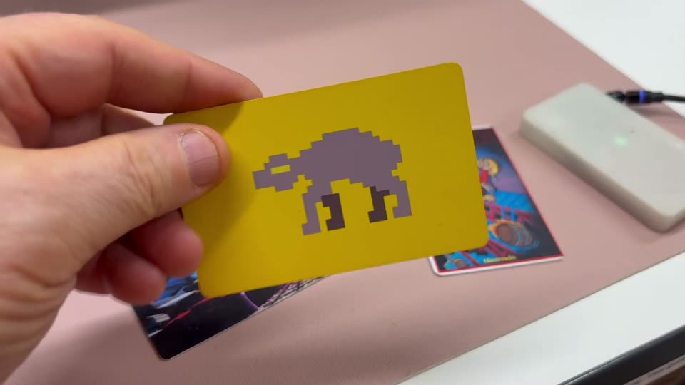

# fujinet-nfc

Start Atari 8-bit games by putting an NFC card on a small reader, like
[Zaparoo](https://zaparoo.org/) on a MiSTer, but for a real Atari 400/800, XL or XE with a
[FujiNet](https://fujinet.online/).

- The reader (Wemos D1 mini + PN532, ESPHome) reads a disk image path from the card, for example
  `tnfs://apps.irata.online/Atari_8-bit/Games/Homesoft/M/MULE.xex`, and tells the FujiNet over WiFi to
  mount it.
- With a Tasmota smart plug in front of the Atari, the reader also restarts the Atari (off, wait,
  on; the off time is adjustable, 1 to 30 seconds, default 2), and the game boots on its own.
- The reader writes cards itself. No Home Assistant, no PC, no cloud.
- Web interface and messages in English or German (two firmware images).

**Videos:** [tap a card, the game starts](https://www.youtube.com/watch?v=JJhER-jWl_A) · [flash the reader from the browser](https://www.youtube.com/watch?v=k8EXn6m4_JI)

## Get started

1. **Parts:** [parts list](docs/parts-en.md) ([Stückliste, Deutsch](docs/stueckliste-de.md)), with shops and
   prices. The wiring is in the [wiring diagram](docs/img/wiring.svg).
2. **Flash page:** open <https://wolfsoftgmbh.github.io/fujinet-nfc/> in Chrome or Edge on a computer,
   plug in the reader over USB and install. Nothing to install on the computer. The page also lets you
   enter your WiFi over USB.
3. **Guide:** [English](docs/guide-en.md) · [Deutsch](docs/anleitung-de.md). It covers building, flashing,
   WiFi, preparing the FujiNet, writing cards, the smart plug and troubleshooting.

Requirements: FujiNet firmware v1.6.1 or later. Disk, program and cassette images
(`.atr .atx .xex .cas`); no cartridges.

## Release

Firmware images (English and German, first flash and update) are on the
[release page](https://github.com/wolfsoftgmbh/fujinet-nfc/releases). They contain
no WiFi data: set it over USB on the flash page or over the reader's own network "FujiNet-NFC". WiFi
saved this way survives updates. Changes: [CHANGELOG.md](CHANGELOG.md).

## Build it yourself

[firmware/README.md](firmware/README.md) explains the sources, `make check` and `make firmware`.
Contributions are welcome: [CONTRIBUTING.md](CONTRIBUTING.md).

## License

Copyright (C) 2026 Wolfsoft GmbH. GPL-3.0, see [LICENSE](LICENSE). The local copy of the `pn532` component
in `firmware/components/pn532/` comes from ESPHome (Copyright (c) 2019 ESPHome; C++ part GPL-3.0, Python
part MIT, see [its LICENSE](firmware/components/pn532/LICENSE) and the README there).
