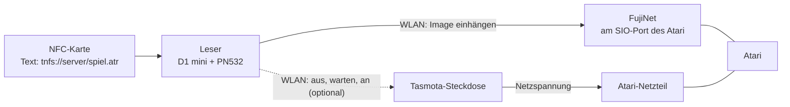
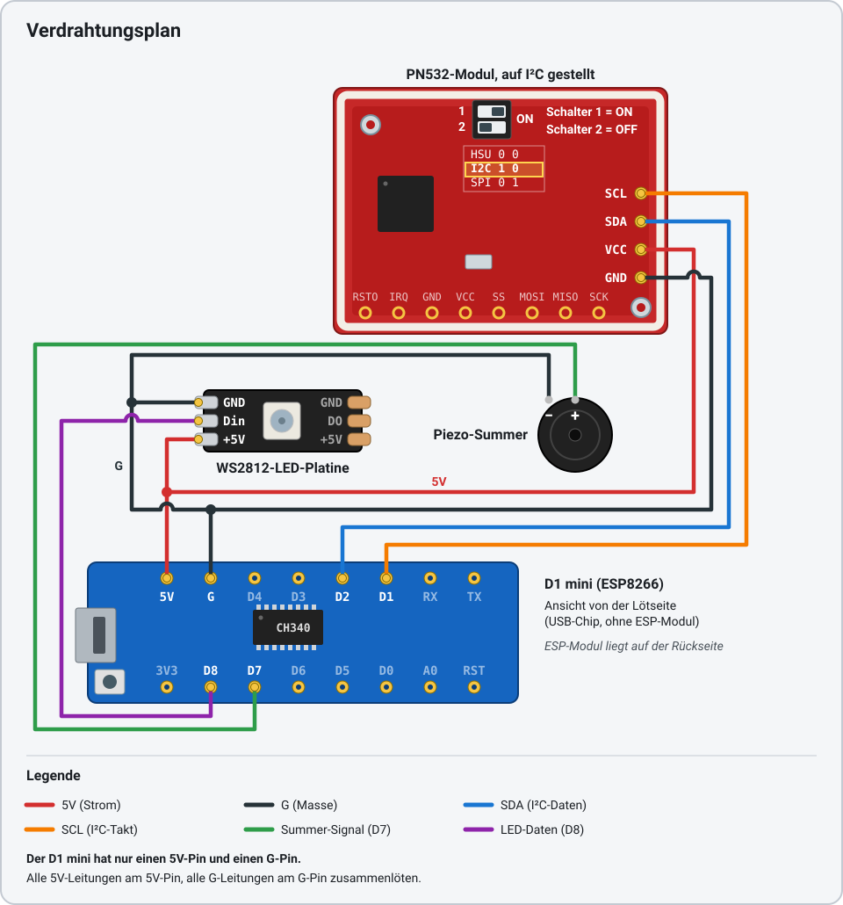
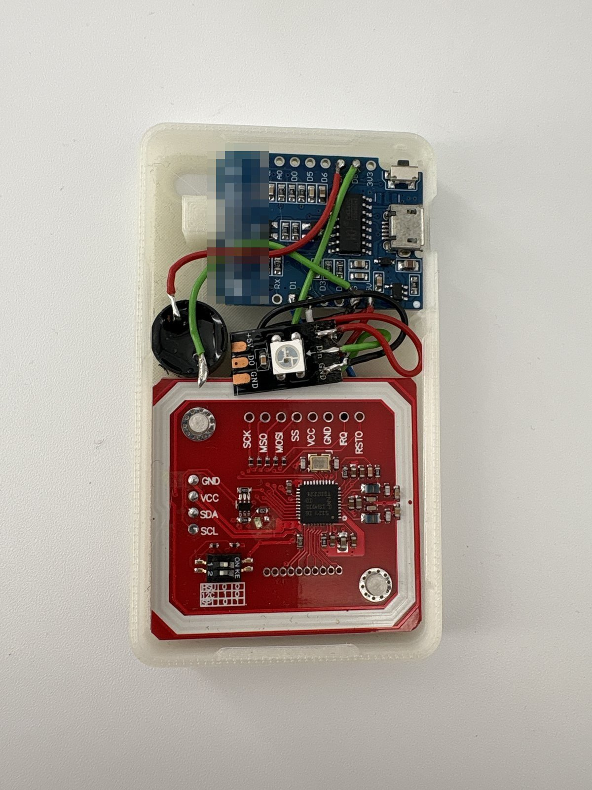
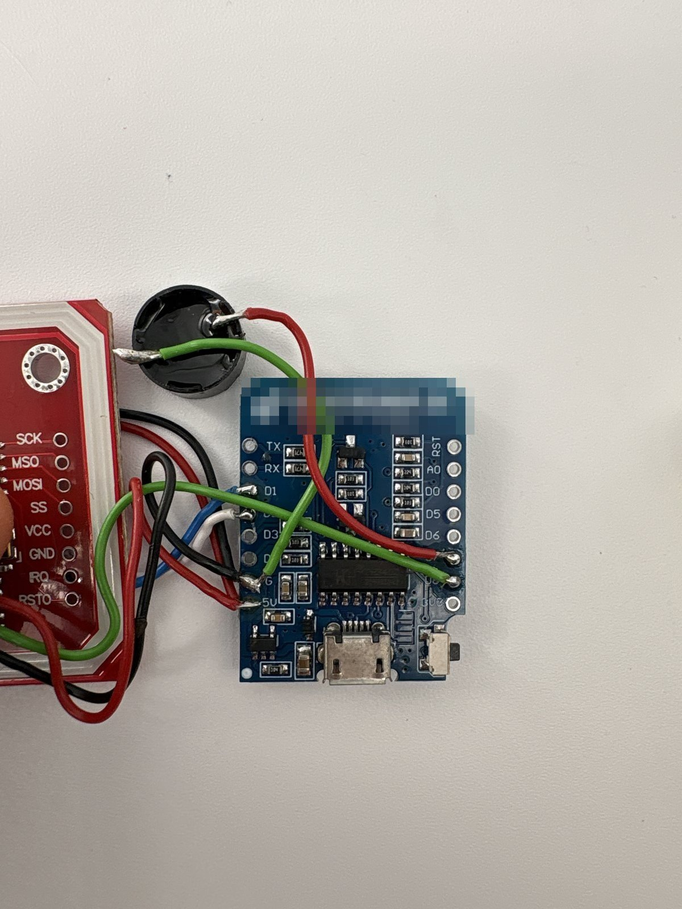
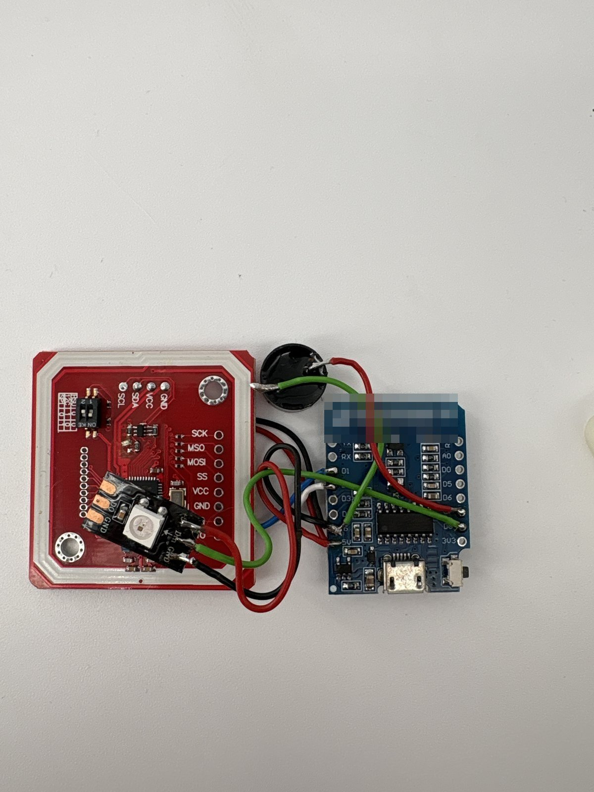
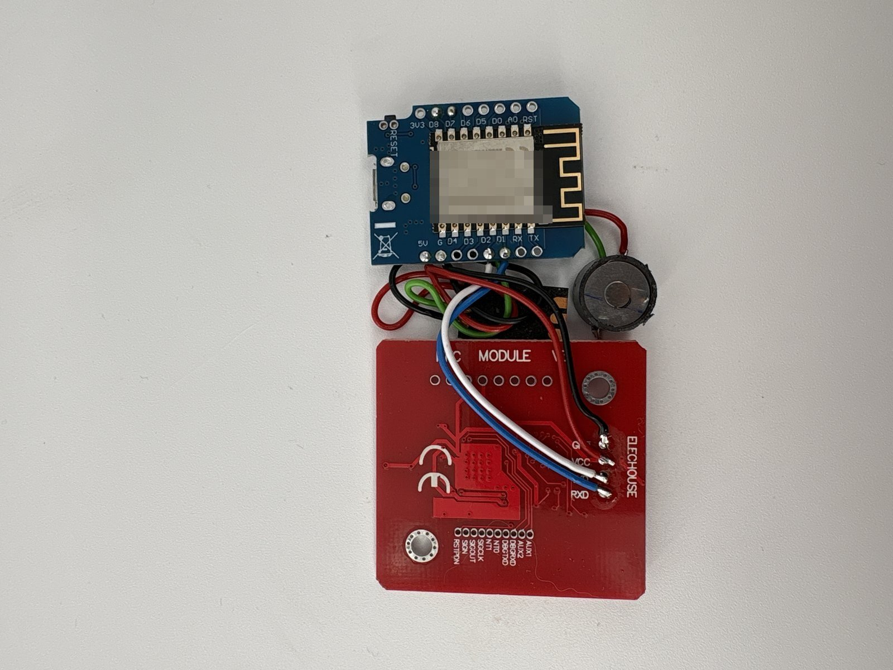

# FujiNet-NFC-Leser: Atari-8-Bit-Spiele per Karte starten

Karte auflegen, und auf Deinem Atari startet das Spiel. Der Leser liest den Pfad eines Disk-Images
von einer NFC-Karte und sagt Deinem [FujiNet](https://fujinet.online/) über das WLAN, es einzuhängen.
Mit einer Tasmota-Steckdose startet der Leser den Atari auch gleich neu, und das Spiel bootet von
selbst. Du brauchst keinen Home Assistant, keinen PC und keine Cloud.

Das Prinzip ist dasselbe wie bei [Zaparoo](https://zaparoo.org/) am MiSTer, nur für einen echten
Atari 400/800, XL oder XE mit FujiNet.



Der Leser liest den Text auf der Karte und sagt dem FujiNet, es soll dieses Image in das Laufwerk D1
einhängen. Mit der optionalen Steckdose schaltet der Leser danach das Netzteil des Atari aus, wartet
und schaltet es wieder ein, und das Spiel bootet von selbst.

## Inhalt

1. [Benötigtes Material](#1-benötigtes-material)
2. [Leser bauen](#2-leser-bauen)
3. [Firmware flashen](#3-firmware-flashen)
4. [Leser ins WLAN bringen](#4-leser-ins-wlan-bringen)
5. [FujiNet vorbereiten](#5-fujinet-vorbereiten)
6. [Einstellungen des Lesers](#6-einstellungen-des-lesers)
7. [Karten beschreiben](#7-karten-beschreiben)
8. [Spielen: Start von Hand](#8-spielen-start-von-hand)
9. [Vollautomatisch mit Tasmota-Steckdose](#9-vollautomatisch-mit-tasmota-steckdose)
10. [Töne, Farben und Meldungen](#10-töne-farben-und-meldungen)
11. [Fehlersuche](#11-fehlersuche)
12. [Leser aktualisieren](#12-leser-aktualisieren)
13. [Grenzen und Sicherheit](#13-grenzen-und-sicherheit)

## 1. Benötigtes Material

### Der Leser

| Teil | Hinweis |
|---|---|
| Wemos D1 mini (ESP8266) | Original oder guter Nachbau. Das Projekt [tagreader](https://github.com/adonno/tagreader) warnt, dass manche AZ-Delivery-Boards nicht liefen. Ein D1 mini Pro geht auch. |
| PN532-NFC-Modul | Das verbreitete rote „PN532 NFC RFID Module V3“ mit I2C. |
| Passiver Summer | Muss **passiv** sein: Der Leser spielt Melodien per PWM. Ein aktiver Summer piept nur. |
| Eine WS2812-LED | Eine einzelne adressierbare RGB-LED (WS2812/WS2812B), etwa auf einer kleinen Platine. |
| Kabel, Lötkolben | Neun kurze Leitungen (siehe [Abschnitt 2](#2-leser-bauen)). |
| USB-Netzteil | Ein ordentliches 5-V-Netzteil mit mindestens 1 A. Schreiben braucht mehr Strom als Lesen (siehe [Fehlersuche](#11-fehlersuche)). |
| Gehäuse (optional) | Der Leser ist genauso verdrahtet wie adonnos [tagreader](https://github.com/adonno/tagreader), dessen 3D-Druck-Gehäuse im Ordner `STLs` passt. |

Eine vollständige Stückliste mit Preisen und Händlerlinks: [stueckliste-de.md](stueckliste-de.md).

### Karten

NFC-Karten, -Sticker oder -Schlüsselanhänger vom Typ **NTAG213, NTAG215 oder NTAG216**. NTAG215 hat
Platz für lange Pfade und ist günstig. MIFARE-Classic-Karten sind nicht zu empfehlen.

### Auf der Atari-Seite

| Teil | Hinweis |
|---|---|
| Atari 400/800, XL oder XE | Getestet an einem 800XL. |
| FujiNet | Mit Firmware **ab v1.6.1**. Ältere Firmware kennt keinen Mount-Befehl über die Weboberfläche ([Abschnitt 5](#5-fujinet-vorbereiten)). |
| USB-Netzteil für das FujiNet | Empfohlen. Ohne ist das FujiNet aus, sobald der Atari aus ist, und nimmt keine Karte an. Für den Vollautomatik-Betrieb nötig. |
| Tasmota-Steckdose (optional) | Für den Vollautomatik-Betrieb ([Abschnitt 9](#9-vollautomatisch-mit-tasmota-steckdose)). Jede Steckdose mit [Tasmota](https://tasmota.github.io/) geht. |

## 2. Leser bauen

### PN532 auf I2C stellen

Das PN532-Modul hat zwei kleine Schalter. **Schalter 1 auf ON, Schalter 2 auf OFF.** Das wählt I2C.
Sonst findet der Leser das Modul nicht.

### Verdrahtung



Die Zeichnung ordnet die Bauteile so an, dass sich möglichst wenige Leitungen kreuzen; im Gehäuse liegen
sie anders (Fotos unten). Die Pins sitzen an den Stellen der echten Platinen. Der D1 mini ist von der
Bauteileseite gezeigt (ESP-Modul oben), die I2C-Leiste des PN532 hat GND, VCC, SDA, SCL, die WS2812-Platine
die Eingangsseite +5V, Din, GND. Die farbigen Leitungen sind die Signale, rot ist 5V, schwarz ist G (Masse). Kleine Bögen heißen: Die
Leitungen kreuzen sich nur im Bild, sie berühren sich nicht; ein Punkt heißt: Hier laufen Leitungen
zusammen. Beide Versorgungspins gibt es am D1 mini nur **einmal**: Alle 5V-Leitungen (PN532, LED) und
alle G-Leitungen (PN532, Summer, LED) treffen sich dort und werden zusammengelötet.

| Von | An D1 mini |
|---|---|
| PN532 VCC | 5V |
| PN532 GND | G |
| PN532 SDA | D2 |
| PN532 SCL | D1 |
| Summer + | D7 |
| Summer − | G |
| WS2812 DIN (Dateneingang) | D8 |
| WS2812 5V / VCC | 5V |
| WS2812 GND | G |

### So sieht er aus

Der fertige Leser in einem 3D-gedruckten Gehäuse: oben der D1 mini, links der Summer, in der Mitte die
LED-Platine, unten der PN532. Die Kabelfarben auf den Fotos sind andere als in der Zeichnung.



| Verdrahtung am D1 mini | Alle Teile nebeneinander | Rückseite |
|---|---|---|
|  |  |  |

Die Signalpins stehen so in der Firmware (`firmware/fujinet-nfc.yaml`): Summer an `D7`, LED-Daten an
`D8`; der I2C-Bus nutzt die Standardpins des D1 mini, `D2` (SDA) und `D1` (SCL). Es sind dieselben
Pins wie beim tagreader. Dessen Schaltplan und Gehäuse kannst Du also als Vorlage nehmen.

Tipps:

- Über der Antenne des PN532 kein Metall, und LED oder D1 mini nicht auf die Antenne legen. Karten
  werden durch einige Millimeter Kunststoff gelesen.
- Im Gehäuse die Stelle markieren, an die die Karte gehört: die Mitte der PN532-Antenne.

## 3. Firmware flashen

Die Firmware gibt es in zwei Sprachen. Wähle eine, Weboberfläche und Meldungen sind dann in dieser
Sprache.

### Flash-Seite (am einfachsten, empfohlen)

Das Projekt hat eine Flash-Seite, die die Firmware per USB aufspielt, ohne dass Du etwas auf dem
Rechner installierst: **<https://wolfsoftgmbh.github.io/fujinet-nfc/>**

1. **Chrome oder Edge** auf einem Windows-, Mac- oder Linux-Rechner nehmen. Firefox, Safari, Handys
   und Tablets können nicht mit USB-Geräten sprechen.
2. Den D1 mini mit einem USB-**Datenkabel** an den Rechner stecken (manche Kabel laden nur). Beim
   Flashen versorgt das USB-Kabel den Leser mit Strom, ein eigenes Netzteil ist dafür nicht nötig.
3. Die Flash-Seite öffnen und **Leser installieren (Deutsch)** oder **Leser installieren (Englisch)**
   klicken.
4. Im Fenster den USB-Anschluss des Lesers wählen und auf Verbinden klicken.
5. Das Fenster fragt, ob das Gerät vorher **gelöscht (Erase)** werden soll. Bei einem neuen Leser geht
   beides. Hat der Leser Dein WLAN schon gespeichert, löscht Erase es; ohne Haken bleibt es erhalten.
6. Warten, bis die Installation fertig ist (etwa eine Minute). Danach fragt das Fenster nach Namen und
   Passwort Deines WLANs: eintragen (siehe [Abschnitt 4](#4-leser-ins-wlan-bringen)).

Die Fenster, die sich beim Installieren öffnen, sind auf Englisch, auch bei der deutschen Firmware.
Sie kommen von ESP Web Tools, und das gibt es nur auf Englisch. Die wichtigsten Knöpfe:

| Im Fenster | Bedeutung |
|---|---|
| Install / Next | Firmware aufspielen / weiter |
| Erase device | Gerät vorher löschen (auch das gespeicherte WLAN) |
| Connect to Wi-Fi / Change Wi-Fi | WLAN eintragen / ändern |
| Network, Password, Connect | WLAN-Name, Passwort, verbinden |
| Skip / Close | überspringen / schließen |

Taucht kein Anschluss auf: Der D1 mini hat einen CH340-USB-Chip. Windows und ältere macOS-Versionen
brauchen dann den CH340-Treiber des Chipherstellers. Probier auch ein anderes USB-Kabel.

**Linux:** Der Browser braucht die Erlaubnis, den seriellen Anschluss (zum Beispiel `/dev/ttyUSB0`) zu
öffnen. Bleibt die Anschlussliste leer oder schlägt das Öffnen fehl, prüfe mit `ls -l /dev/ttyUSB0`:
Das Gerät gehört einer Gruppe, und Dein Benutzer muss darin sein. Die Gruppe heißt unter Debian und
Ubuntu `dialout`, unter Arch Linux `uucp`, zum Beispiel `sudo usermod -aG dialout $USER`. Danach
abmelden und neu anmelden.

**„Failed to execute 'open' on 'SerialPort': Failed to open serial port“:** Der Anschluss ist noch
belegt. Meist hält ihn ein zweiter offener Tab oder Dialog der Flash-Seite oder ein anderes Programm
(zum Beispiel ein serieller Monitor). Schließ den anderen Tab oder beende das Programm; hilft das nicht,
starte den Browser neu. Unter Linux gibt die oben beschriebene fehlende Gruppenzugehörigkeit dieselbe
Meldung aus.

### ESPHome Web (mit heruntergeladener Datei)

Alternativ [ESPHome Web](https://web.esphome.io/) mit einer Datei von der
[Release-Seite](https://github.com/wolfsoftgmbh/fujinet-nfc/releases) des Projekts:

| Datei | Zweck |
|---|---|
| `fujinet-nfc-de.factory.bin` | Erstes Flashen, Deutsch |
| `fujinet-nfc-en.factory.bin` | Erstes Flashen, Englisch |
| `fujinet-nfc-de.ota.bin` / `fujinet-nfc-en.ota.bin` | Spätere Updates über WLAN ([Abschnitt 12](#12-leser-aktualisieren)) |

ESPHome Web in Chrome oder Edge öffnen, **Connect** klicken, den USB-Anschluss des Lesers wählen,
**Install** klicken, die `…factory.bin` wählen und warten, bis es fertig ist. Der Linux-Hinweis oben
gilt auch hier.

### Auf der Kommandozeile

Mit [esptool](https://docs.espressif.com/projects/esptool/) (Python):

```bash
esptool --chip esp8266 --port /dev/ttyUSB0 write-flash 0x0 fujinet-nfc-de.factory.bin
```

Den Anschluss durch Deinen ersetzen (`COM3` unter Windows, `/dev/cu.usbserial-…` unter macOS). Das WLAN
richtest Du dann wie in [Abschnitt 4](#4-leser-ins-wlan-bringen) über den Hotspot des Lesers ein.

## 4. Leser ins WLAN bringen

Die Firmware enthält keine WLAN-Daten. Du gibst dem Leser Dein WLAN einmal ein, auf einem von zwei
Wegen. Der Leser speichert es getrennt von der Firmware, es **übersteht Updates**.

### Per USB (Improv), direkt nach dem Flashen

Auf der Flash-Seite fragt das Fenster nach der Installation nach Namen und Passwort Deines WLANs.
Eintragen. Der Leser verbindet sich mit Deinem WLAN. Mit dem Haken **Passwort anzeigen** unter dem Passwortfeld prüfst Du, was Du getippt hast.

Das geht auch später: Flash-Seite öffnen, Install klicken, USB-Anschluss wählen. Bei einem Leser, auf
dem die Firmware schon läuft, bietet das Fenster **Connect to Wi-Fi** oder **Change Wi-Fi** an; das
wählen, statt noch einmal zu installieren.

### Über das eigene Netz des Lesers (Hotspot)

Findet der Leser kein WLAN, öffnet er ein eigenes.

1. Den Leser mit Strom versorgen. Nach etwa 20 Sekunden leuchtet die LED **gelb**: Das
   Einrichtungsnetz ist offen.
2. Mit Handy oder Laptop das WLAN **FujiNet-NFC** wählen.
3. Die Einrichtungsseite öffnet sich von selbst. Sonst im Browser `http://192.168.4.1` aufrufen.
4. Dein WLAN wählen, Passwort eingeben, speichern.
5. Der Leser verbindet sich, spielt einen kurzen Dreiklang, die LED blitzt grün und geht aus.

Den Haken **Passwort anzeigen** gibt es auf dieser Seite nicht; tippe das Passwort also langsam. Ist es
falsch, kommt der Leser nicht ins WLAN und öffnet nach etwa 20 Sekunden wieder **FujiNet-NFC**.

### Falsches WLAN gewählt?

Hat der Leser sich mit dem falschen Netz verbunden, bleibt er dort, solange es erreichbar ist. Zum
Ändern den Leser per USB anschließen, die Flash-Seite öffnen, **Install** klicken, den Anschluss wählen
und **Change Wi-Fi** nehmen. Zeigt die Liste keine Netze, nur **Join other…**: das wählen und den Namen Deines
WLANs von Hand eintippen.

### Den Leser finden

FujiNet und Leser müssen sich erreichen können. Nimm also dasselbe Netz wie das FujiNet (oder Netze,
die untereinander geroutet sind).

Die Adresse des Lesers suchst Du in der Geräteliste Deines Routers (das Gerät heißt `fujinet-nfc`)
oder probierst im Browser `http://fujinet-nfc.local`. Diese Adresse öffnen: Das ist die Weboberfläche
des Lesers. Leg Dir ein Lesezeichen an.

## 5. FujiNet vorbereiten

### Firmware-Version prüfen

Der Leser braucht FujiNet-Firmware **ab v1.6.1**. Die Version steht unten auf der Weboberfläche des
FujiNet (seine IP im Browser öffnen) und im Programm CONFIG am Atari. Ältere Versionen, etwa 1.5,
verstehen den Mount-Befehl nicht.

### FujiNet-Firmware aktualisieren

1. Den **FujiNet-Flasher** für Deinen Rechner herunterladen, von der
   [FujiNet-Downloadseite](https://fujinet.online/download/) oder den
   [Flasher-Releases](https://github.com/FujiNetWIFI/fujinet-flasher/releases).
2. Vorher WLAN-Namen und Host-Liste des FujiNet notieren (beides zeigt CONFIG). Das Update kann sie
   zurücksetzen.
3. Das FujiNet vom Atari abziehen und per USB an den Rechner stecken.
4. Den Flasher starten, USB-Anschluss wählen, Plattform (Atari) und neueste stabile Version wählen,
   flashen. Windows braucht eventuell den CP210x-USB-Treiber, den die Downloadseite verlinkt.
5. Das FujiNet wieder an den Atari stecken und einschalten. Fragt CONFIG nach dem WLAN, neu
   einrichten.

Mehr Hilfe: [FujiNet-Flasher-Wiki](https://github.com/FujiNetWIFI/fujinet-platformio/wiki/FujiNet-Flasher).

### Was sonst noch stimmen muss

- **Kein Passwort** auf der Weboberfläche des FujiNet. So ist es ab Werk.
- **Die IP des FujiNet notieren.** CONFIG zeigt sie in den WLAN-Einstellungen, Dein Router auch. Am
  besten gibst Du ihm im Router eine feste Adresse (DHCP-Reservierung), damit der Leser es immer
  findet.
- **Das FujiNet über USB versorgen**, wenn es geht (siehe [Abschnitt 1](#1-benötigtes-material)).

## 6. Einstellungen des Lesers

Öffne die Weboberfläche des Lesers. Die Einstellungen sind:

| Einstellung | Bedeutung | Vorgabe |
|---|---|---|
| FujiNet-Adresse | IP oder Hostname Deines FujiNet, auch mit Port: `192.168.0.50` oder `http://192.168.0.50:8000` | leer, **muss gesetzt werden** |
| Host-Slot | Host-Slot für Karten **ohne** Servernamen (0 bis 7; in CONFIG Slot 1 bis 8). Karten mit `tnfs://` beachten ihn nicht. | 0 |
| Laufwerk | In welches Laufwerk gemountet wird (1 bis 8; 1 ist D1, das Startlaufwerk) | 1 |
| Ton | Töne ein oder aus. Die LED arbeitet immer. | ein |
| Statuslicht | Zwischen den Karten atmet die LED schwach: grün = bereit, rot = FujiNet oder Steckdose nicht erreichbar ([Abschnitt 10](#10-töne-farben-und-meldungen)). Aus = LED zwischen den Karten dunkel. | ein |
| Steckdose (Tasmota) | IP einer Tasmota-Steckdose, die den Atari versorgt. Leer = kein automatischer Neustart ([Abschnitt 9](#9-vollautomatisch-mit-tasmota-steckdose)). | leer |
| Ausschaltzeit Steckdose | Wie lange die Steckdose den Atari bei einem Neustart ausgeschaltet lässt, in Sekunden (1 bis 30). Gilt nur mit Steckdose. | 2 s |

Die Einstellungen überstehen einen Stromausfall. **Letzte Karte** zeigt Kennung und Text der letzten
Karte, **Letztes Ergebnis**, was der Leser damit getan hat. Schau dort zuerst hin, wenn etwas nicht
klappt. **Status** zeigt, ob der Leser FujiNet und Steckdose gerade erreicht: `Bereit`,
`FujiNet nicht erreichbar`, `Steckdose nicht erreichbar` oder `FujiNet-Adresse fehlt`.

## 7. Karten beschreiben

### Was auf eine Karte kommt

Eine Karte trägt eine Zeile Text, den Pfad zu einem Disk-Image. Zwei Formen gehen:

| Form | Beispiel | Bedeutung |
|---|---|---|
| **Mit Server (empfohlen)** | `tnfs://apps.irata.online/Atari_8-bit/Games/Homesoft/M/MULE.xex` | Der Leser fragt das FujiNet nach seiner Host-Liste und nimmt den Slot dieses Servers. Steht der Server nicht darin, trägt der Leser ihn in den ersten **freien** Slot ein. Belegte Slots überschreibt er nie. Jede Karte funktioniert für sich. |
| Reiner Pfad | `/spiele/meinspiel.atr` | Nimmt den Host-Slot aus den Einstellungen. |

Regeln:

- Die Datei muss auf `.atr`, `.atx`, `.xex` oder `.cas` enden (Groß- und Kleinschreibung egal).
  Cartridge-Images (`.car`) gehen nicht, das FujiNet kann sie nicht laden.
- Nirgends ein `&` oder `=`. Die Weboberfläche des FujiNet verkraftet sie nicht. Solche Dateien
  umbenennen.
- Leerzeichen und Sonderzeichen gehen: `tnfs://apps.irata.online/Atari_8-bit/Games/Homesoft/S/Star Raiders.xex`.
- Der Servername besteht aus Buchstaben, Ziffern, Punkten und Bindestrichen.
- Die SD-Karte im FujiNet ist der Host `SD`, also liest `tnfs://SD/spiele/meinspiel.atr` von der
  SD-Karte. Sie muss mit **FAT32** formatiert sein.

### Pfade finden

Über die Weboberfläche des FujiNet: Sie kann jeden Host seiner Liste durchblättern. Oder in CONFIG am
Atari. Schreib den Pfad genau so ab, wie er dort steht, mit Groß- und Kleinschreibung. Öffentliche
TNFS-Server, die viele FujiNets schon eingetragen haben, sind unter anderem `fujinet.online` (auch
`tnfs.fujinet.online`), `apps.irata.online` und `fujinet.pl`.

Dieselbe Datei kann auf verschiedenen Servern unter verschiedenen Pfaden liegen. Ein Pfad funktioniert
nur auf dem Server, zu dem er gehört.

### Mit dem Leser beschreiben

1. Die Weboberfläche des Lesers öffnen.
2. Den Kartentext unter **Karte beschreiben: Pfad** eintragen.
3. **Nächste Karte beschreiben** klicken, **einmal**. Die LED wird lila.
4. Innerhalb von 30 Sekunden eine Karte auflegen, flach und ruhig. Liegt schon eine Karte da, kurz
   abheben und wieder auflegen: Der Leser schreibt nur auf eine frisch aufgelegte Karte.
5. Guter Ton und grüne LED: fertig. Tiefes „Moep“ und rote LED: noch einmal.
6. Die Karte abheben und neu auflegen. Jetzt liest der Leser sie und mountet sie, als Probe.

Was vorher auf der Karte stand, ist danach weg. Ohne Karte bricht der Leser nach 30 Sekunden ab.

### Mit dem Handy beschreiben

Jede App, die NDEF-Text schreibt, geht, etwa NXP TagWriter oder NFC Tools: **Schreiben**, dann
**Text** (nicht URL), den Kartentext eintragen und die Karte ans Handy halten.

## 8. Spielen: Start von Hand

Das geht ohne Steckdose:

1. Der Atari ist **an** (dann ist das FujiNet an und im WLAN).
2. Die Karte auflegen und auf den guten Ton warten (LED zwei Sekunden grün). Das FujiNet hat das
   Spiel jetzt in D1.
3. Den Atari aus- und wieder einschalten.
4. CONFIG startet und zeigt das Spiel in D1. **OPTION gedrückt halten**, bis das Spiel zu laden
   beginnt.

Das FujiNet-Handbuch beschreibt es so: „Press and hold OPTION from the main screen, the browser, or
the mount screen. CONFIG mounts everything in your drive slots, steps out of the way, and restarts the
computer — which boots from drive slot 1 exactly as if a real diskette were spinning in a real drive.
Keep holding OPTION until the program begins to load.“ (Quelle:
[FujiNet-Handbücher](https://github.com/FujiNetWIFI/fujinet-manuals), Abschnitt zum Booten.) Auf XL
und XE schaltet OPTION dabei auch das eingebaute BASIC ab, das viele Spiele stört.

Zum Wechseln die nächste Karte auflegen, während der Atari läuft, auf den guten Ton warten, dann aus
und an.

**Ohne CONFIG:** In der Weboberfläche des FujiNet lässt sich der Boot-Modus auf **mount and boot**
stellen. Das FujiNet überspringt dann CONFIG und bootet sofort, was in D1 liegt. OPTION brauchst Du
nicht mehr, aber BASIC bleibt an (siehe [Fehlersuche](#11-fehlersuche)). Für CONFIG den Boot-Modus
dort zurückstellen.

## 9. Vollautomatisch mit Tasmota-Steckdose

Mit einer Steckdose vor dem Atari-Netzteil startet der Leser den Atari selbst neu: Karte drauf, guter
Ton, der Atari geht zwei Sekunden aus und wieder an, das Spiel bootet.

### Verkabelung

- **In die Steckdose:** nur das Netzteil des Atari.
- **Nicht in die Steckdose:** Leser und FujiNet. Das FujiNet braucht ein eigenes USB-Netzteil, sonst
  wird es mit dem Atari abgeschaltet und muss erst wieder ins WLAN.

### Tasmota-Steckdose einrichten

1. Einstecken. Eine neue Steckdose öffnet ein WLAN namens `tasmota-…`. Mit dem Handy verbinden.
2. `http://192.168.4.1` öffnen, Dein WLAN wählen, Passwort eingeben, speichern. Die Steckdose startet
   neu und verbindet sich.
3. Ihre IP im Router suchen und im Browser öffnen: die Tasmota-Weboberfläche.
4. **Der Steckdose eine feste Adresse geben**: Im Router dieselbe IP für sie reservieren
   (DHCP-Reservierung). Ändert sich die Adresse, findet der Leser die Steckdose nicht mehr.
5. Optional, aber nützlich: unter **Tools → Console** `PowerOnState 1` eingeben. Dann schaltet sie
   nach einem Stromausfall wieder ein.
6. **Kein Webpasswort** an der Steckdose (Tasmota: Configuration → Configure Other, Feld *Web Admin
   Password* leer). Der Leser schickt keine Anmeldung, siehe „HTTP 401“ unten.
7. Probe: `http://<IP der Steckdose>/cm?cmnd=Power%20Off` im Browser öffnen, einen Moment später
   `http://<IP der Steckdose>/cm?cmnd=Power%20On`. Die Steckdose schaltet aus und wieder ein.

Den Ablauf *aus, warten, an* macht der Leser selbst: Er schickt `Power Off`, wartet die Zeit aus
**Ausschaltzeit Steckdose** (Vorgabe 2 s, 1 bis 30 s) und schickt `Power On`. Tasmotas `Backlog … Delay`
nutzt er nicht mehr, weil jede andere Anfrage, die während des `Delay` bei der Steckdose eintrifft
(ein zweiter Leser, Home Assistant), die Wartezeit vorzeitig beendet. Schlägt `Power On` fehl,
versucht der Leser es bis zu dreimal im Abstand von 1 s. Fällt der Leser genau in der Pause aus,
bleibt die Steckdose aus: von Hand einschalten.
Solange die Steckdose aus ist, nimmt der Leser keine weitere Karte an und gibt keinen Ton. Bootet das Spiel nicht zuverlässig, probier eine längere Ausschaltzeit: Manche Netzteile brauchen einen
Moment, um sich zu entladen.

### Leser und FujiNet einstellen

1. In der Weboberfläche des Lesers die IP der Steckdose unter **Steckdose (Tasmota)** eintragen.
2. Bei Bedarf **Ausschaltzeit Steckdose** ändern.
3. In der Weboberfläche des FujiNet den Boot-Modus auf **mount and boot** stellen.

Jetzt: Karte auflegen, der Leser meldet `Gemountet: … — Atari startet neu`, der Atari startet neu und
das Spiel bootet.

### Wenn etwas schiefgeht

| Anzeichen | Ursache und Abhilfe |
|---|---|
| `Steckdose hat den Neustart abgelehnt (HTTP 401)` | Die Steckdose hat ein Webpasswort. Löschen (siehe Schritt 6 oben). |
| `Steckdose hat den Neustart abgelehnt (HTTP 404)` oder eine andere Nummer | Die Adresse gehört zu einem anderen Gerät, nicht zu einer Tasmota-Steckdose. IP prüfen. |
| `FujiNet hat auf den Mount nicht geantwortet — lädt der Atari gerade? Karte noch einmal auflegen` | Das FujiNet hat die Mount-Anfrage zweimal (im Abstand von 2 s) nicht beantwortet. Während der Atari vom FujiNet lädt, antwortet es nicht. Warten, bis das Laden fertig ist, oder den Atari zurücksetzen, dann die Karte noch einmal auflegen. |
| `Steckdose nicht erreichbar — Adresse prüfen` | Die Steckdose ist nicht eingesteckt, die IP ist falsch oder hat sich geändert, oder sie hängt in einem anderen Netz. IP im Browser öffnen und prüfen; der Steckdose eine feste IP geben. |
| `Steckdose hat nicht wieder eingeschaltet — bitte von Hand einschalten` | Die Steckdose hat ausgeschaltet, aber `Power On` dreimal nicht beantwortet. Von Hand einschalten, Netzwerk der Steckdose prüfen. |
| Der Atari startet neu, landet aber im BASIC oder auf einem blauen Bildschirm | Der Boot-Modus des FujiNet ist nicht **mount and boot** (in der Weboberfläche des FujiNet einstellen), oder das Spiel braucht BASIC aus, siehe [Fehlersuche](#11-fehlersuche). |
| Der Mount klappt, aber der Atari startet nicht neu | Keine Steckdose eingetragen, oder die Steckdosen-Meldung von oben steht unter „Letztes Ergebnis“. |

## 10. Töne, Farben und Meldungen

Der **gute Ton** ist ein kurzer, aufsteigender Jingle aus sieben Noten, der auf einer hohen, gehaltenen
Note endet. Der **schlechte Ton** ist ein langsames „Moep“ aus vier Noten (D#, C, F, C). Der **Startton**
nach dem WLAN-Aufbau besteht aus drei schnell aufsteigenden Noten (C, G, H). Bei ausgeschaltetem **Ton**
sind alle drei stumm; die LED arbeitet immer.

| Lage | Ton | LED | Meldung unter „Letztes Ergebnis“ |
|---|---|---|---|
| Leser bereit (nach dem Einschalten) | Start | grün, kurz | |
| Ruhe: FujiNet (und Steckdose, falls eingetragen) erreichbar — Karte kann kommen | | grün, atmet schwach | (Status: `Bereit`) |
| Ruhe: FujiNet oder Steckdose nicht erreichbar, etwa Atari aus, während das FujiNet am Atari-Strom hängt | | rot, atmet schwach | (Status sagt, was fehlt) |
| Ruhe: FujiNet-Adresse nicht eingetragen | | rot, atmet schwach | (Status: `FujiNet-Adresse fehlt`) |
| Kein WLAN, Einrichtungsnetz offen | | gelb | |
| Karte gelesen, Anfrage läuft | | blau | |
| Mount gelungen | gut | grün, 2 s | `Gemountet: <Kartentext>` |
| Mount gelungen, Steckdose eingetragen | gut | grün, 2 s | `Gemountet: <Kartentext> — Atari startet neu` |
| Karte ohne Image-Pfad | schlecht | rot, 2 s | `Unbekannte Karte — kein Image-Pfad` |
| FujiNet-Adresse nicht eingetragen | schlecht | rot, 2 s | `FujiNet-Adresse fehlt` |
| FujiNet antwortet mit Fehler | schlecht | rot, 2 s | `FujiNet meldet Fehler — Pfad, Slot oder Laufwerk prüfen` |
| FujiNet verlangt Anmeldung | schlecht | rot, 2 s | `FujiNet verweigert den Zugriff — Passwortschutz?` |
| FujiNet nicht erreichbar | schlecht | rot, 2 s | `FujiNet nicht erreichbar — Adresse prüfen` |
| Andere Antwort | schlecht | rot, 2 s | `Unerwartete Antwort (HTTP <Nummer>)` |
| FujiNet zu alt für `tnfs://`-Karten | schlecht | rot, 2 s | `FujiNet liefert keine Host-Liste — Firmware ab v1.6.1 nötig` |
| Alle 8 Host-Slots belegt | schlecht | rot, 2 s | `Kein freier Host-Slot im FujiNet für <Server>` |
| Server ließ sich nicht eintragen | schlecht | rot, 2 s | `Server ließ sich im FujiNet nicht eintragen: <Server>` |
| Steckdose nicht erreichbar | schlecht | rot, 2 s | `Steckdose nicht erreichbar — Adresse prüfen` |
| Steckdose lehnt ab (Passwort gesetzt, falsches Gerät) | schlecht | rot, 2 s | `Steckdose hat den Neustart abgelehnt (HTTP <Nummer>)` |
| FujiNet antwortet auf den Mount nicht (zweimal) | schlecht | rot, 2 s | `FujiNet hat auf den Mount nicht geantwortet — lädt der Atari gerade? Karte noch einmal auflegen` |
| Steckdose bleibt nach der Pause aus | schlecht | rot, 2 s | `Steckdose hat nicht wieder eingeschaltet — bitte von Hand einschalten` |
| Wartet auf Karte zum Beschreiben | | lila | `Warte auf Karte zum Beschreiben: <Text>` |
| Karte beschrieben | gut | grün, 2 s | `Karte beschrieben: <Text> — zum Prüfen abheben und neu auflegen` |
| Text zum Schreiben ungültig | schlecht | rot, 2 s | `Kein gültiger Kartentext zum Schreiben (…)` |
| Karte ließ sich nicht beschreiben | schlecht | rot, 2 s | `Karte ließ sich nicht beschreiben` |
| 30 s keine Karte zum Beschreiben | schlecht | rot, 2 s | `Schreiben abgebrochen — keine Karte aufgelegt` |

Dieselbe Karte wird innerhalb von drei Sekunden nur einmal gelesen.

**Das Ruhelicht.** Alle 10 Sekunden fragt der Leser das FujiNet (und die Steckdose, falls eingetragen)
ab. Ein Gerät gilt erst nach **zwei Fehlschlägen hintereinander** als weg, weil das FujiNet einzelne
Anfragen manchmal einige Sekunden lang nicht beantwortet. Bis zur ersten Abfrage nach dem Einschalten
(bis zu 10 Sekunden) bleibt die LED dunkel. Das zählt beim Neustart mit Steckdose:

- Bei der Vorgabe von 2 Sekunden Ausschaltzeit wird nichts rot.
- Bei **langer Ausschaltzeit** und einem FujiNet am **Atari-Anschluss** ist auch das FujiNet aus. Nach
  zwei Fehlschlägen (ein Ausfall von etwa 10 bis 20 Sekunden oder länger) wird die LED rot, und Status
  zeigt `FujiNet nicht erreichbar`. Grün wird sie wieder bei der ersten gelungenen Abfrage, nachdem das
  FujiNet zurück ist, das dauert einige Sekunden länger als die Ausschaltzeit. Das ist so gewollt.
- Mit eigenem USB-Netzteil (empfohlen) bleibt das FujiNet erreichbar, und die LED bleibt grün.

## 11. Fehlersuche

| Problem | Ursache und Abhilfe |
|---|---|
| `FujiNet nicht erreichbar` | Das FujiNet ist aus (es hängt am Atari-Strom und der Atari ist aus), verbindet sich nach dem Einschalten noch mit dem WLAN, oder seine IP hat sich geändert. Karte bei laufendem Atari auflegen, nach dem Einschalten ein paar Sekunden warten, dem FujiNet eine feste IP geben. |
| `FujiNet liefert keine Host-Liste …` | FujiNet-Firmware älter als v1.6.1. Aktualisieren ([Abschnitt 5](#5-fujinet-vorbereiten)). |
| `FujiNet meldet Fehler …` | Falscher Pfad, falscher Server oder die Datei fehlt. Groß- und Kleinschreibung prüfen. Bei reinen Pfaden den Host-Slot prüfen. |
| Oft `Karte ließ sich nicht beschreiben` | Schwaches Netzteil. Schreiben zieht mehr Strom als Lesen. Ein kräftigeres USB-Netzteil oder den USB-Anschluss eines Rechners nehmen, die Karte flach und mittig auflegen. |
| `Unbekannte Karte — kein Image-Pfad` | Auf der Karte steht kein Text oder etwas anderes (etwa eine URL oder ein Zaparoo-Befehl). Neu beschreiben. |
| CONFIG zeigt das Spiel, dann „Boot Error“ | Das Image ist keine Startdisk (etwa eine Datendisk oder eine Werkzeugdisk für DOS). Ein bootfähiges Image wählen. |
| Blauer Bildschirm mit Cursor oder Absturz nach dem Neustart | Oft BASIC: Auf XL/XE bleibt es ohne OPTION an. Manche älteren Spiele brauchen es aus oder laufen auf XL/XE gar nicht. Den Weg über CONFIG mit OPTION probieren, oder eine angepasste Fassung (Sammlungen wie Homesoft passen Spiele für XL/XE an). |
| Kartenwechsel ändert das Spiel nicht | Die neue Karte lag auf, während das FujiNet aus war. Vor dem Neustart auf den guten Ton warten. |
| LED gelb | Der Leser hat kein WLAN: nie eingerichtet, beim Flashen gelöscht oder das Netz ist weg. Neu einrichten ([Abschnitt 4](#4-leser-ins-wlan-bringen)). |
| `tnfs://SD/…` scheitert | Keine SD-Karte oder nicht FAT32. Das FujiNet erkennt eine Karte nur beim Einschalten. |
| Ein öffentlicher Server geht plötzlich nicht | Öffentliche TNFS-Server kommen und gehen. Einen anderen nehmen oder die Spiele auf die SD-Karte des FujiNet legen. |

## 12. Leser aktualisieren

1. Die `…ota.bin` in der gewünschten Sprache von der [Release-Seite](https://github.com/wolfsoftgmbh/fujinet-nfc/releases)
   des Projekts herunterladen.
2. Die Weboberfläche des Lesers öffnen, den Abschnitt **OTA Update** suchen, die Datei wählen und
   hochladen.
3. Der Leser startet neu. Die Einstellungen bleiben, solange die Sprache dieselbe bleibt, und das WLAN
   bleibt auch, weil es getrennt von der Firmware gespeichert ist.

Ein Wechsel der Sprache setzt die Einstellungen zurück (FujiNet-Adresse, Host-Slot, Laufwerk,
Steckdose, Ausschaltzeit), weil jede Sprache sie unter eigenen Namen speichert. Dasselbe passiert einmal
beim Update von einer Fassung vor der englischen (Gerätename `fujinet-leser`). Dann die Werte in der
Weboberfläche neu eintragen.

Die `…factory.bin` noch einmal aufzuspielen (siehe [Abschnitt 3](#3-firmware-flashen)) geht ebenfalls;
mit gesetztem Erase-Haken löscht das das gespeicherte WLAN und die Einstellungen.

## 13. Grenzen und Sicherheit

- **Keine Cartridges.** Nur Disk-, Programm- und Kassettenabbilder (`.atr .atx .xex .cas`). Spiele
  mit mehreren Disks brauchen weiterhin Handarbeit.
- **Kein Passwort auf der Weboberfläche des FujiNet.** Ist eines gesetzt, verweigert das FujiNet den
  Mount.
- **Der Leser hat kein Passwort** und gehört ins Heimnetz. Weboberfläche und Update sind für jeden im
  selben Netz offen, wie die Weboberfläche des FujiNet ab Werk. Wer die Firmware selbst baut, kann ein
  OTA- und ein Webpasswort setzen ([firmware/README.md](../firmware/README.md)).
- Der Leser weiß nicht, ob gerade ein Spiel läuft. Er mountet (und startet mit Steckdose neu), sobald
  eine Karte aufliegt.
- Andere Steckdosen als Tasmota (etwa Shelly) werden noch nicht unterstützt.
