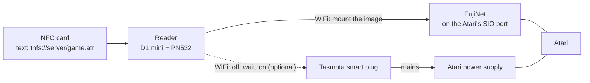
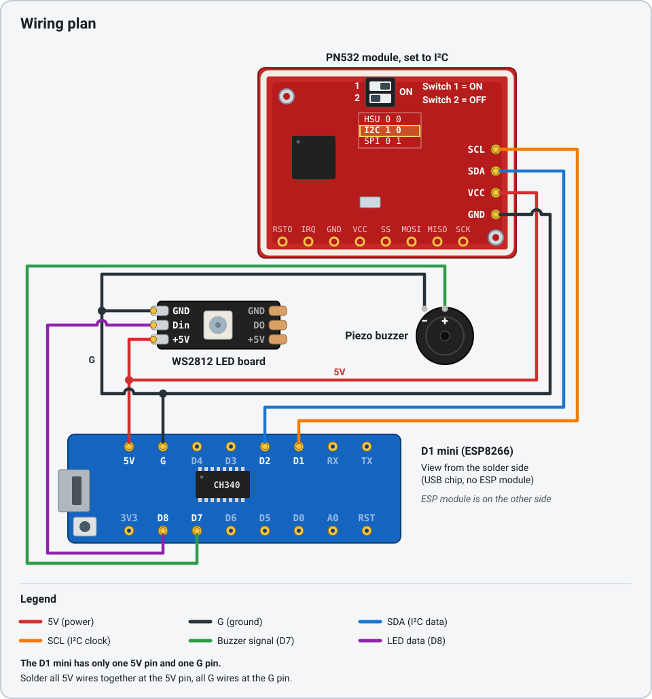
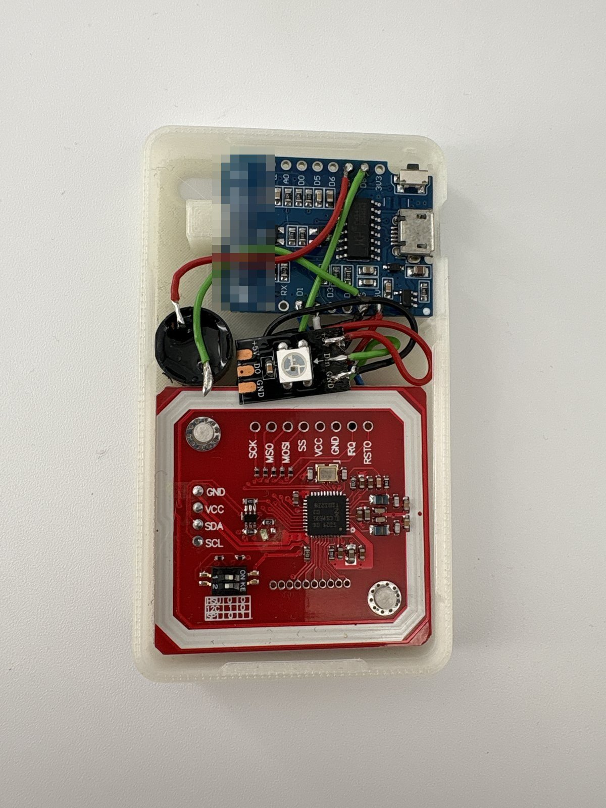
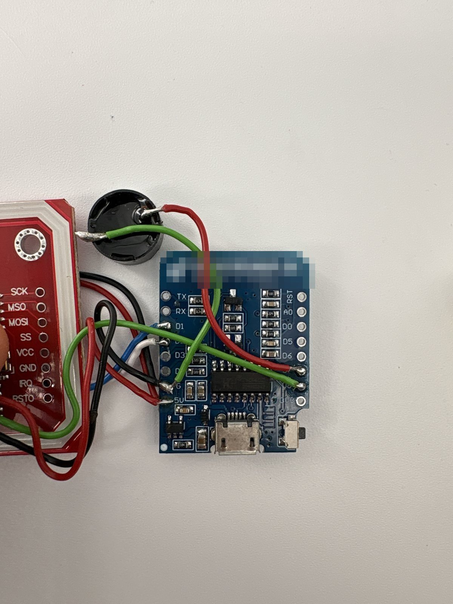
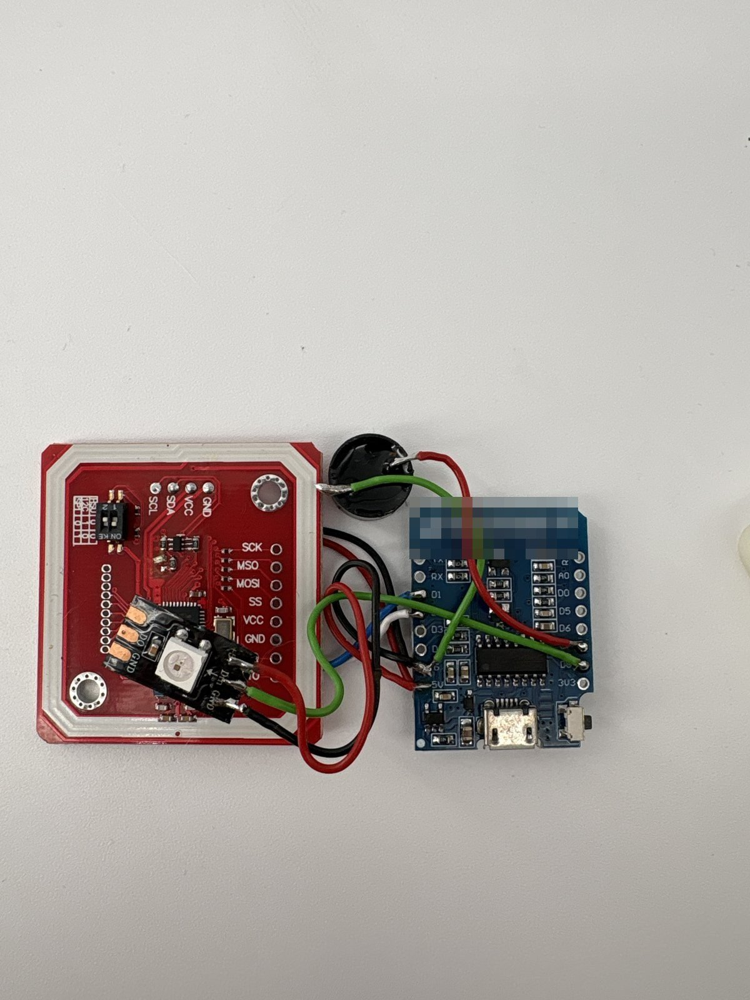
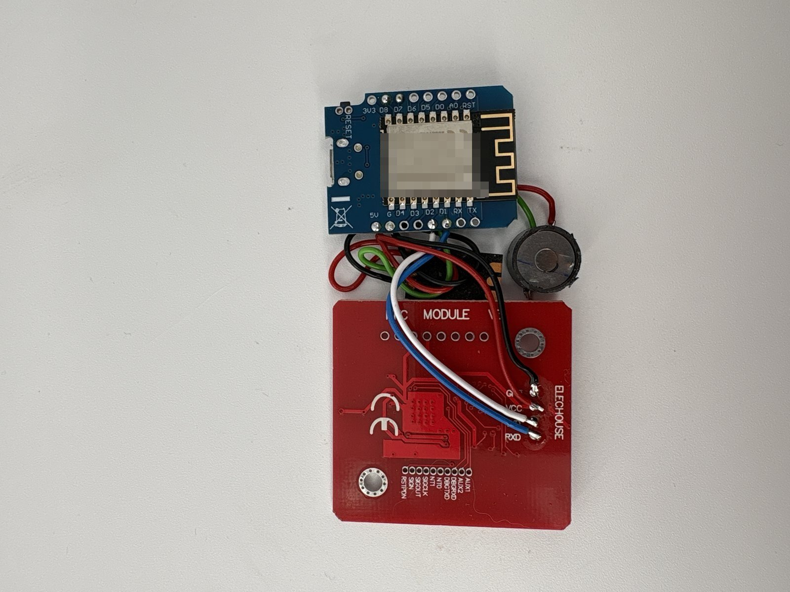

# FujiNet NFC reader: start Atari 8-bit games with a card

Put a card on the reader and the game starts on your Atari. The reader reads the path of a disk image
from an NFC card and tells your [FujiNet](https://fujinet.online/) over WiFi to mount it. If you also
add a Tasmota smart plug, the reader restarts the Atari for you and the game boots by itself. You need
no Home Assistant, no PC and no cloud.

It works like [Zaparoo](https://zaparoo.org/) on a MiSTer, but for a real Atari 400/800, XL or XE with
a FujiNet.



The reader reads the text on the card and tells the FujiNet to mount that image into drive D1. With the
optional smart plug the reader then switches the Atari's power supply off, waits, and switches it on,
so the game boots by itself.

## Contents

1. [What you need](#1-what-you-need)
2. [Build the reader](#2-build-the-reader)
3. [Flash the firmware](#3-flash-the-firmware)
4. [Connect the reader to your WiFi](#4-connect-the-reader-to-your-wifi)
5. [Prepare the FujiNet](#5-prepare-the-fujinet)
6. [Settings of the reader](#6-settings-of-the-reader)
7. [Write cards](#7-write-cards)
8. [Play: start a game by hand](#8-play-start-a-game-by-hand)
9. [Fully automatic with a Tasmota smart plug](#9-fully-automatic-with-a-tasmota-smart-plug)
10. [Sounds, colours and messages](#10-sounds-colours-and-messages)
11. [Troubleshooting](#11-troubleshooting)
12. [Updating the reader](#12-updating-the-reader)
13. [Limits and security](#13-limits-and-security)

## 1. What you need

### The reader

| Part | Notes |
|---|---|
| Wemos D1 mini (ESP8266) | The original or a good clone. The [tagreader](https://github.com/adonno/tagreader) project warns that some AZ-Delivery boards did not work. A D1 mini Pro works too. |
| PN532 NFC module | The common red "PN532 NFC RFID module V3" with I2C. |
| Passive buzzer | Must be **passive**: the reader plays melodies by PWM. An active buzzer only beeps. |
| One WS2812 LED | A single addressable RGB LED (WS2812/WS2812B), for example on a small breakout board. |
| Wires, soldering iron | Nine short wires (see [section 2](#2-build-the-reader)). |
| USB power supply | A decent 5 V supply with at least 1 A. Writing cards needs more current than reading (see [Troubleshooting](#11-troubleshooting)). |
| Case (optional) | The reader uses the same wiring as adonno's [tagreader](https://github.com/adonno/tagreader), so its 3D-printable case in the `STLs` folder fits. |

A complete parts list with prices and shop links: [parts-en.md](parts-en.md).

### Cards

NFC cards, stickers or key fobs of type **NTAG213, NTAG215 or NTAG216**. NTAG215 has room for long
paths and is cheap. MIFARE Classic cards are not recommended.

### The Atari side

| Part | Notes |
|---|---|
| Atari 400/800, XL or XE | Tested on an 800XL. |
| FujiNet | With firmware **v1.6.1 or later**. Older firmware has no web command for mounting ([section 5](#5-prepare-the-fujinet)). |
| USB power supply for the FujiNet | Recommended. Without it the FujiNet is off whenever the Atari is off and cannot accept a card. For the fully automatic mode it is required. |
| Tasmota smart plug (optional) | For the fully automatic mode ([section 9](#9-fully-automatic-with-a-tasmota-smart-plug)). Any plug running [Tasmota](https://tasmota.github.io/) works. |

## 2. Build the reader

### Set the PN532 to I2C

The PN532 module has two small switches. Set **switch 1 to ON and switch 2 to OFF**. This selects
I2C. Without it the reader does not find the module.

### Wiring



The drawing arranges the parts so that as few wires as possible cross; in the case they sit differently
(photos below). The pins are where they are on the real boards: the D1 mini seen from its component side
(ESP module on top), the PN532 I2C header with GND, VCC, SDA, SCL, and the WS2812 board with its input side
+5V, Din, GND. Coloured wires are the signals, red is 5V, black is G (ground). A small arc means the wires
only cross in the picture and do not touch; a dot means wires join there. The D1 mini has each of these two
supply pins only **once**: all 5V wires (PN532, LED) and all G wires (PN532, buzzer, LED) meet there and are
soldered together.

| From | To D1 mini |
|---|---|
| PN532 VCC | 5V |
| PN532 GND | G |
| PN532 SDA | D2 |
| PN532 SCL | D1 |
| Buzzer + | D7 |
| Buzzer − | G |
| WS2812 DIN (data in) | D8 |
| WS2812 5V / VCC | 5V |
| WS2812 GND | G |

### What it looks like

The finished reader in a 3D-printed case: D1 mini at the top, buzzer on the left, LED board in the
middle, PN532 at the bottom. The wire colours on the photos are not the same as in the drawing.



| Wiring at the D1 mini | All parts side by side | Back side |
|---|---|---|
|  |  |  |

The signal pins are the ones in the firmware (`firmware/fujinet-nfc.yaml`): buzzer on `D7`, LED data on
`D8`; the I2C bus uses the D1 mini's default pins `D2` (SDA) and `D1` (SCL). They are the same pins as in
the tagreader project, so its schematic and case can be used as a reference.

Tips:

- Keep the PN532 antenna side free of metal and do not put the LED or the D1 mini on top of the
  antenna. Cards are read through a few millimetres of plastic.
- In a case, mark the spot where the card goes: the centre of the PN532 antenna.

## 3. Flash the firmware

The firmware comes in two languages. Pick one: the web interface and all messages are then in that
language.

### Flash page (easiest, recommended)

The project has a flash page that installs the firmware over USB, with nothing to install on your
computer: **<https://wolfsoftgmbh.github.io/fujinet-nfc/>**

1. Use **Chrome or Edge** on a Windows, Mac or Linux computer. Firefox, Safari, phones and tablets
   cannot talk to USB devices.
2. Plug the D1 mini into the computer with a USB **data** cable (some cables only charge). While
   flashing, the USB cable powers the reader; it needs no power supply of its own for that.
3. Open the flash page and click **Install reader (English)** or **Install reader (German)**.
4. Pick the reader's USB port in the window that opens and click Connect.
5. The window asks whether to **erase** the device first. For a new reader either answer works. If the
   reader already has your WiFi saved, erasing deletes it; leave the box unticked to keep it.
6. Wait until the installation is done (about a minute). The window then asks for the name and password
   of your home WiFi: enter them (see [section 4](#4-connect-the-reader-to-your-wifi)).

If no port shows up: the D1 mini uses a CH340 USB chip. Windows and older macOS versions may need the
CH340 driver from the chip maker. Also try another USB cable.

**Linux:** the browser needs permission to open the serial port (for example `/dev/ttyUSB0`). If the
port list stays empty or opening fails, check `ls -l /dev/ttyUSB0`: the device belongs to a group, and
your user must be in it. That group is `dialout` on Debian and Ubuntu and `uucp` on Arch Linux, for
example `sudo usermod -aG dialout $USER`. Log out and log in again afterwards.

**"Failed to execute 'open' on 'SerialPort': Failed to open serial port":** the port is still in use.
This usually means a second open tab or dialog of the flash page, or another program (for example a
serial monitor), holds it. Close the other tab or quit the program; if that does not help, restart the
browser. On Linux the missing group membership described above gives the same message.

### ESPHome Web (with a downloaded file)

Alternatively use [ESPHome Web](https://web.esphome.io/) with a file from the project's
[release page](https://github.com/wolfsoftgmbh/fujinet-nfc/releases):

| File | Use |
|---|---|
| `fujinet-nfc-en.factory.bin` | First flash, English |
| `fujinet-nfc-de.factory.bin` | First flash, German |
| `fujinet-nfc-en.ota.bin` / `fujinet-nfc-de.ota.bin` | Later updates over WiFi ([section 12](#12-updating-the-reader)) |

Open ESPHome Web in Chrome or Edge, click **Connect**, pick the reader's USB port, click **Install**,
choose the `…factory.bin` file and wait until it is done. The Linux note above applies here too.

### On the command line

With [esptool](https://docs.espressif.com/projects/esptool/) (Python):

```bash
esptool --chip esp8266 --port /dev/ttyUSB0 write-flash 0x0 fujinet-nfc-en.factory.bin
```

Replace the port with yours (`COM3` on Windows, `/dev/cu.usbserial-…` on macOS). WiFi is then set up as
in [section 4](#4-connect-the-reader-to-your-wifi) through the reader's hotspot.

## 4. Connect the reader to your WiFi

The firmware contains no WiFi data. You give the reader your WiFi once, in one of two ways. The reader
stores it separately from the firmware, so it **survives updates**.

### Over USB (Improv), right after flashing

On the flash page the window asks for your WiFi name and password after the installation. Enter them.
The reader connects to your WiFi. Tick **Show password** below the password field to check what you typed.

You can do this later, too: open the flash page, click Install, pick the USB port. For a reader that is
already running the firmware the window offers **Connect to Wi-Fi** or **Change Wi-Fi**; choose it
instead of installing again.

### Over the reader's own network (hotspot)

If the reader finds no WiFi it opens a network of its own.

1. Power the reader. After about 20 seconds the LED turns **yellow**: the setup network is open.
2. On your phone or laptop, join the WiFi network **FujiNet-NFC**.
3. A setup page opens by itself. If it does not, open `http://192.168.4.1` in a browser.
4. Pick your home WiFi, enter the password and save.
5. The reader connects, plays a short three-note tune and the LED flashes green, then goes off.

This page has no **Show password** tick box, so type the password carefully. If it is wrong the reader
does not get onto your WiFi and opens **FujiNet-NFC** again after about 20 seconds.

### Picked the wrong network?

A reader that joined the wrong network stays on it as long as that network is in reach. To change it,
plug the reader in over USB, open the flash page, click **Install**, pick the port and choose
**Change Wi-Fi**. If the list shows no networks, only **Join other…**, choose that and type your WiFi name
by hand.

### Find the reader

The FujiNet and the reader must be able to reach each other, so use the same network as the FujiNet
(or networks that are routed to each other).

Find the reader's address: look in your router's list of devices (the device is called
`fujinet-nfc`), or try `http://fujinet-nfc.local` in a browser. Open that address: this is the
reader's web interface. Bookmark it.

## 5. Prepare the FujiNet

### Check the firmware version

The reader needs FujiNet firmware **v1.6.1 or later**. You see the version at the bottom of the
FujiNet's web interface (open the FujiNet's IP address in a browser) and in the CONFIG program on the
Atari. Older versions (for example 1.5) do not understand the mount command.

### Update the FujiNet firmware

1. Download the **FujiNet-Flasher** for your computer from the
   [FujiNet download page](https://fujinet.online/download/) or the
   [flasher releases](https://github.com/FujiNetWIFI/fujinet-flasher/releases).
2. Before flashing, note your FujiNet's WiFi name and its host list (CONFIG shows both). They may be
   reset by the update.
3. Unplug the FujiNet from the Atari and connect it to the computer by USB.
4. Start the flasher, pick the USB port, choose your platform (Atari) and the latest stable release,
   and flash. Windows may need the CP210x USB driver, which the download page links to.
5. Plug the FujiNet back into the Atari and switch it on. If CONFIG asks for WiFi, set it up again.

More help: [FujiNet-Flasher wiki](https://github.com/FujiNetWIFI/fujinet-platformio/wiki/FujiNet-Flasher).

### Other things to check

- **No password** on the FujiNet web interface. That is the factory default.
- **Note the FujiNet's IP address.** CONFIG shows it in the WiFi settings, your router lists it too.
  Ideally give it a fixed address in your router (DHCP reservation), so the reader always finds it.
- **Power the FujiNet over USB** if you can (see [section 1](#1-what-you-need)).

## 6. Settings of the reader

Open the reader's web interface. The settings are (the names are the ones shown in the English firmware):

| Setting | Meaning | Default |
|---|---|---|
| FujiNet address | IP or hostname of your FujiNet, optionally with port: `192.168.0.50` or `http://192.168.0.50:8000` | empty, **must be set** |
| Host slot | Host slot for cards **without** a server name (0 to 7; this is slot 1 to 8 in CONFIG). Cards with `tnfs://` ignore it. | 0 |
| Drive | Drive to mount into (1 to 8; 1 is D1, the boot drive) | 1 |
| Sound | Sounds on or off. The LED always works. | on |
| Status light | The LED breathes softly between cards: green = ready, red = FujiNet or plug unreachable ([section 10](#10-sounds-colours-and-messages)). Off = LED dark between cards. | on |
| Smart plug (Tasmota) | IP of a Tasmota plug that powers the Atari. Empty = no automatic restart ([section 9](#9-fully-automatic-with-a-tasmota-smart-plug)). | empty |
| Plug off time | How long the plug keeps the Atari switched off during a restart, in seconds (1 to 30). Only used with a plug. | 2 s |

The settings survive a power cut. **Last card** shows the ID and text of the last card, **Last
result** what the reader did with it. Watch these two when something does not work. **Status**
shows whether the reader reaches the FujiNet and the plug right now: `Ready`, `FujiNet unreachable`,
`Smart plug unreachable` or `FujiNet address missing`.

## 7. Write cards

### What goes on a card

A card holds one line of text, a path to a disk image. Two forms work:

| Form | Example | Meaning |
|---|---|---|
| **With server (recommended)** | `tnfs://apps.irata.online/Atari_8-bit/Games/Homesoft/M/MULE.xex` | The reader asks the FujiNet for its host list and uses the slot of this server. If the server is not in the list, the reader adds it to the first **free** slot. It never overwrites a slot that is in use. Every card works on its own. |
| Plain path | `/games/mygame.atr` | Uses the host slot from the settings. |

Rules:

- The file must end in `.atr`, `.atx`, `.xex` or `.cas` (upper or lower case). Cartridge images
  (`.car`) do not work: the FujiNet cannot load them.
- No `&` or `=` anywhere. The FujiNet's web interface cannot handle them. Rename such files.
- Spaces and special characters are fine: `tnfs://apps.irata.online/Atari_8-bit/Games/Homesoft/S/Star Raiders.xex`.
- The server name may contain letters, digits, dots and hyphens.
- The FujiNet's own SD card is the host called `SD`, so `tnfs://SD/games/mygame.atr` reads from the
  SD card. The SD card must be formatted as **FAT32**.

### Finding paths

Use the FujiNet's web interface: it can browse each host in its list. Or browse in CONFIG on the
Atari. Write down the path exactly as shown, including upper and lower case. Public TNFS servers
that come preconfigured in many FujiNets include `fujinet.online` (also `tnfs.fujinet.online`),
`apps.irata.online` and `fujinet.pl`.

Note that the same file can sit at different paths on different servers. A path only works on the
server it belongs to.

### Write with the reader

1. Open the reader's web interface.
2. Type the card text into **Write card: text**.
3. Click **Write next card**, **once**. The LED turns purple.
4. Within 30 seconds put a card on the reader and keep it flat and still. If a card is already lying
   there, lift it and put it back: the reader only writes to a card that has just been placed.
5. Good tune and green LED: done. A low "womp" and red LED: try again.
6. Lift the card and put it back. The reader now reads it and mounts it, as a check.

Whatever was on the card before is replaced. Without a card the reader gives up after 30 seconds.

### Write with a phone

Any app that writes NDEF text records works, for example NXP TagWriter or NFC Tools: choose
**Write**, then **Text** (not URL), enter the card text and hold the card to the phone.

## 8. Play: start a game by hand

This works without a smart plug:

1. The Atari is **on** (so the FujiNet is on and in the WiFi).
2. Put the card on the reader and wait for the good tune (LED green for two seconds). The FujiNet
   now has the game in D1.
3. Switch the Atari off and on.
4. CONFIG starts and shows the game in D1. **Hold OPTION** until the game starts to load.

The FujiNet manual describes it so: "Press and hold OPTION from the main screen, the browser, or the
mount screen. CONFIG mounts everything in your drive slots, steps out of the way, and restarts the
computer — which boots from drive slot 1 exactly as if a real diskette were spinning in a real drive.
Keep holding OPTION until the program begins to load." (Source: [FujiNet manuals](https://github.com/FujiNetWIFI/fujinet-manuals),
chapter on booting.) On XL and XE machines OPTION also switches off the built-in BASIC, which many
games need.

To switch games, put the next card on while the Atari is running, wait for the good tune, then power
cycle.

**Without CONFIG:** In the FujiNet's web interface you can set the boot mode to **mount and boot**.
The FujiNet then skips CONFIG and boots whatever is in D1 right away. You no longer need OPTION, but
BASIC stays on (see [Troubleshooting](#11-troubleshooting)). To get CONFIG back, set the boot mode
back in the FujiNet's web interface.

## 9. Fully automatic with a Tasmota smart plug

With a smart plug in front of the Atari's power supply, the reader restarts the Atari by itself:
card on, good tune, the Atari goes off for two seconds and back on, the game boots.

### Wiring

- **Into the smart plug:** only the Atari's power supply.
- **Not into the smart plug:** the reader and the FujiNet. The FujiNet needs its own USB power
  supply, otherwise it is switched off together with the Atari and has to reconnect to WiFi first.

### Set up the Tasmota plug

1. Plug it in. A new plug opens a WiFi network named `tasmota-…`. Join it with your phone.
2. Open `http://192.168.4.1`, choose your WiFi, enter the password, save. The plug restarts and
   joins your WiFi.
3. Find its IP address in your router and open it in a browser: the Tasmota web interface.
4. **Give the plug a fixed address**: in your router, reserve the same IP for it every time (DHCP
   reservation). If the address changes, the reader no longer finds the plug.
5. Optional but useful: in **Tools → Console** type `PowerOnState 1`. The plug then switches on
   again after a power cut.
6. **No web password** on the plug (Tasmota: Configuration → Configure Other, field *Web Admin
   Password* empty). The reader sends no login; see "HTTP 401" below.
7. Test: open `http://<plug IP>/cm?cmnd=Power%20Off` in the browser, and a moment later
   `http://<plug IP>/cm?cmnd=Power%20On`. The plug switches off and on again.

The reader does *off, wait, on* itself: it sends `Power Off`, waits for the time set in **Plug off
time** (default 2 s, 1 to 30 s) and sends `Power On`. It does not use Tasmota's `Backlog … Delay`
any more, because any other request reaching the plug during the `Delay` (a second reader, Home
Assistant) ends the wait early. If `Power On` fails, the reader tries up to three times, 1 s apart.
If the reader itself fails exactly during the pause, the plug stays off: switch it on by hand.
While the plug is off, the reader accepts no further card and makes no sound. If the game does not boot reliably, try a longer off time: some power supplies need a moment to
discharge.

### Set up the reader and the FujiNet

1. In the reader's web interface enter the plug's IP under **Smart plug (Tasmota)**.
2. Optionally change **Plug off time**.
3. In the FujiNet's web interface set the boot mode to **mount and boot**.

Now: put a card on, and the reader shows `Mounted: … — restarting the Atari`, the Atari restarts and
the game boots.

### If something goes wrong

| Symptom | Cause and fix |
|---|---|
| `Smart plug refused the restart (HTTP 401)` | The plug has a web password. Clear it (see step 6 above). |
| `Smart plug refused the restart (HTTP 404)` or another number | The address belongs to a different device, not a Tasmota plug. Check the IP. |
| `FujiNet did not answer the mount — is the Atari loading? Place the card again` | The FujiNet did not answer the mount request twice (2 s apart). It does not answer while the Atari is loading from it. Wait until loading has finished or reset the Atari, then place the card again. |
| `Smart plug unreachable — check the address` | The plug is unplugged, the IP is wrong or has changed, or it is in another network. Open the IP in a browser to check; give the plug a fixed IP. |
| `Smart plug did not switch back on — switch it on by hand` | The plug switched off but did not answer `Power On` three times. Switch it on by hand, check the plug's network. |
| The Atari restarts but lands in BASIC or a blue screen | The FujiNet boot mode is not **mount and boot** (set it in the FujiNet's web interface), or the game needs BASIC off, see [Troubleshooting](#11-troubleshooting). |
| The mount works but the Atari does not restart | No plug entered, or the plug message above appears under "Last result". |

## 10. Sounds, colours and messages

The **good tune** is a short rising jingle of seven notes ending on a high held note. The **bad tune**
is a slow "womp" of four notes (D#, C, F, C). The **ready tune** after the WiFi comes up is three quick
rising notes (C, G, B). With **Sound** switched off all three are silent; the LED always works.

| Situation | Tune | LED | Message under "Last result" |
|---|---|---|---|
| Reader ready (after power-up) | ready | green, briefly | |
| Idle: FujiNet (and plug, if set) reachable — put a card on | | green, breathing softly | (Status: `Ready`) |
| Idle: FujiNet or plug unreachable, for example Atari off while the FujiNet runs on Atari power | | red, breathing softly | (Status says which) |
| Idle: FujiNet address not entered | | red, breathing softly | (Status: `FujiNet address missing`) |
| No WiFi, setup network open | | yellow | |
| Card read, request running | | blue | |
| Mount succeeded | good | green, 2 s | `Mounted: <card text>` |
| Mount succeeded, plug set | good | green, 2 s | `Mounted: <card text> — restarting the Atari` |
| Card without an image path | bad | red, 2 s | `Unknown card — no image path` |
| FujiNet address not set | bad | red, 2 s | `FujiNet address missing` |
| FujiNet answers with an error | bad | red, 2 s | `FujiNet reports an error — check path, slot or drive` |
| FujiNet asks for a login | bad | red, 2 s | `FujiNet denied access — password set?` |
| FujiNet unreachable | bad | red, 2 s | `FujiNet unreachable — check the address` |
| Any other answer | bad | red, 2 s | `Unexpected answer (HTTP <number>)` |
| FujiNet too old for `tnfs://` cards | bad | red, 2 s | `FujiNet returned no host list — firmware v1.6.1 or later needed` |
| All 8 host slots in use | bad | red, 2 s | `No free host slot on the FujiNet for <server>` |
| Server could not be added | bad | red, 2 s | `Could not add the server to the FujiNet: <server>` |
| Plug unreachable | bad | red, 2 s | `Smart plug unreachable — check the address` |
| Plug refuses (password set, wrong device) | bad | red, 2 s | `Smart plug refused the restart (HTTP <number>)` |
| FujiNet does not answer the mount (twice) | bad | red, 2 s | `FujiNet did not answer the mount — is the Atari loading? Place the card again` |
| Plug stays off after the pause | bad | red, 2 s | `Smart plug did not switch back on — switch it on by hand` |
| Waiting for a card to write | | purple | `Waiting for a card to write: <text>` |
| Card written | good | green, 2 s | `Card written: <text> — lift and put it back to test` |
| Text to write is invalid | bad | red, 2 s | `No valid card text to write (…)` |
| Card could not be written | bad | red, 2 s | `Card could not be written` |
| No card within 30 s | bad | red, 2 s | `Writing cancelled — no card placed` |

The same card is read only once within three seconds.

**The idle light.** Every 10 seconds the reader asks the FujiNet (and the plug, if one is entered). A
device only counts as gone after **two failed checks in a row**, because the FujiNet sometimes ignores
a single request for a few seconds. Until the first check after power-up (up to 10 seconds) the LED
stays dark. This matters during a restart with the plug:

- With the default off time of 2 seconds nothing turns red.
- With a **long off time** and the FujiNet powered from the **Atari's** port the FujiNet is off as
  well. After two failed checks (an outage of roughly 10 to 20 seconds or longer) the LED turns red and
  Status says `FujiNet unreachable`. It turns green again at the first successful check after the
  FujiNet is back, which takes a few seconds more than the plug's off time. That is expected.
- With its own USB power supply (recommended) the FujiNet stays reachable and the LED stays green.

## 11. Troubleshooting

| Problem | Cause and fix |
|---|---|
| `FujiNet unreachable` | The FujiNet is off (it runs on the Atari's power and the Atari is off), still connecting to WiFi after power-up, or its IP changed. Put the card on while the Atari runs, wait a few seconds after power-up, give the FujiNet a fixed IP. |
| `FujiNet returned no host list …` | FujiNet firmware older than v1.6.1. Update it ([section 5](#5-prepare-the-fujinet)). |
| `FujiNet reports an error …` | Wrong path, wrong server or the file does not exist. Check upper/lower case. For plain paths check the host slot. |
| `Card could not be written`, often | Weak power supply. Writing draws more current than reading. Use a stronger USB supply or a computer's USB port, place the card flat and in the centre. |
| `Unknown card — no image path` | The card has no text or a different kind of record (for example a URL or a Zaparoo command). Write it again. |
| CONFIG shows the game, but "Boot Error" | The image is not a boot disk (for example a data disk or a DOS tools disk). Choose a bootable image. |
| Blue screen with a cursor, or a crash, after the restart | Often BASIC: on XL/XE it stays on unless OPTION is held. Some older games need it off or do not run on XL/XE at all. Try the CONFIG way with OPTION, or a fixed version (collections such as Homesoft adapt games for XL/XE). |
| Changing the card does not change the game | The new card was put on while the FujiNet was off. Wait for the good tune before restarting. |
| LED yellow | The reader has no WiFi: it was never set up, was erased while flashing, or the network is gone. Set it up again ([section 4](#4-connect-the-reader-to-your-wifi)). |
| `tnfs://SD/…` fails | No SD card, or not FAT32. The FujiNet only detects a card at power-up. |
| A public server suddenly fails | Public TNFS servers come and go. Use another server or put the games on the FujiNet's SD card. |

## 12. Updating the reader

1. Download the `…ota.bin` file in the language you want from the project's
   [release page](https://github.com/wolfsoftgmbh/fujinet-nfc/releases).
2. Open the reader's web interface, find the **OTA update** section, choose the file and upload.
3. The reader restarts. Your settings stay as long as you keep the same language, and the WiFi stays,
   because it is stored separately from the firmware.

Switching the language resets the settings (FujiNet address, host slot, drive, smart plug, plug off
time), because each language stores them under its own names. The same happens once when updating from
a build before the English release (device name `fujinet-leser`). Enter them again in the web
interface.

Flashing the `…factory.bin` again (see [section 3](#3-flash-the-firmware)) also works; with the erase
option ticked it deletes the saved WiFi and the settings.

## 13. Limits and security

- **No cartridges.** Only disk, program and cassette images (`.atr .atx .xex .cas`). Multi-disk games
  need manual work.
- **No password on the FujiNet web interface.** If one is set, the FujiNet refuses the mount.
- **The reader has no password** and belongs in your home network. Its web interface and updates
  are open to everyone on the same network, like the FujiNet's web interface out of the box. If you
  build the firmware yourself you can set an OTA password and a web password
  ([firmware/README.md](../firmware/README.md)).
- The reader cannot tell whether a game is running. It mounts (and restarts, with a plug) whenever a
  card is put on.
- Smart plugs other than Tasmota (for example Shelly) are not supported yet.
